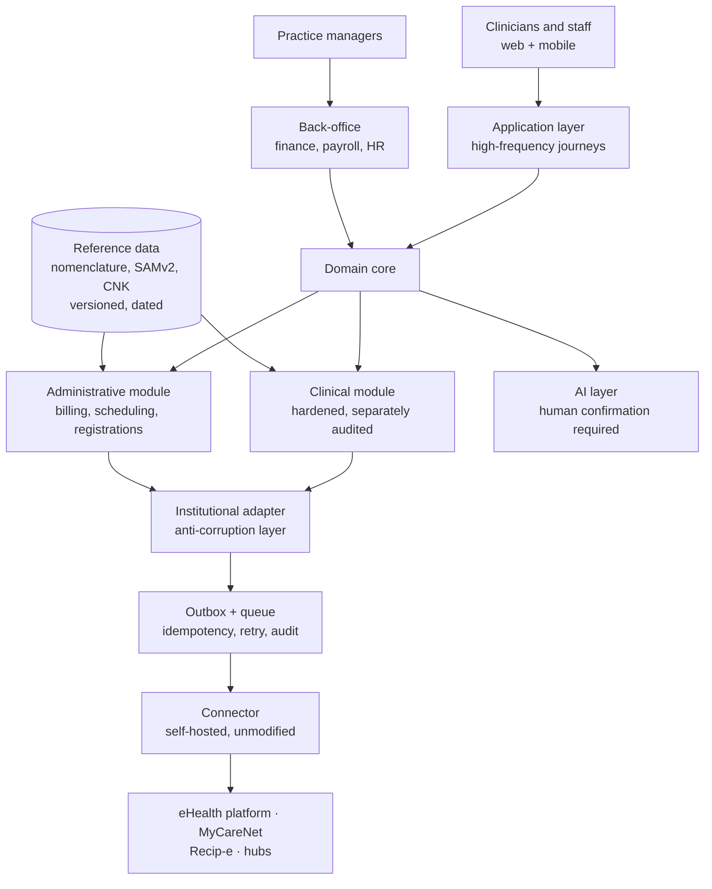

# Integration architecture

How a modern system actually connects to Belgian institutional rails. The central problem: the estate
is **SOAP/XML with SAML security and KMEHR payloads**, while new products are REST/JSON. Something has
to bridge that, and the choice of what is one of the first real architecture decisions.

## What you are integrating with

| Dimension | Reality |
|---|---|
| Protocol | ~80 published APIs, almost all **SOAP**; two FHIR R4 |
| Security | WS-Security, **SAML assertions** from the STS, XML signing, eHealth certificates |
| Payloads | **KMEHR** XML for clinical content; INAMI fixed-position layouts or XSD-defined XML for billing |
| Versioning | Per service, independently (`v1.0` … `v5.2`) |
| Availability | Published incident history; degraded operation is routine |
| Reference data | Downloaded files with effective dates, not live APIs |

See [[ehealth-platform-and-apis]] and [[mycarenet-services-and-flows]] for the detail.

## Three ways to bridge

### Option 1 — The eHealth platform's own technical connector

The platform publishes connector libraries intended to be embedded in medical software. Canonical, but
it carries the platform's own assumptions about deployment and is oriented to a single-practitioner
desktop lineage *(deployment and multi-user characteristics — to verify against current documentation)*.

### Option 2 — The Free Health Connector (FHC)

Developed by **iCure** (with Taktik), the FHC is described as **the de facto market solution** for
connecting to Belgian state eHealth services, and **the only open-source implementation** of the
Belgian eHealth connectors.

What it is, technically:

- A **middleware gateway** presenting a **unified REST API** over the Belgian estate.
- A **multi-user (MMU)** variant of the standard eHealth connector — significant, because the standard
  connector's lineage is single-practitioner and a healthcare centre is inherently multi-user.
- **Protocol translation**: JSON REST requests into **KMEHR and SOAP envelopes**.
- **Identity management** with Belgian **eID keystores** and **SAML token exchange**.
- Implements **WS-Security**, **end-to-end encryption (ETEE)** and **certificate revocation checking**.

Coverage: Recip-e (prescriptions), MyCareNet insurability, eHealthBox, **consent**, **therapeutic
link**, address book, and the secure token service. iCure states it implements **22 homologated
e-services** on the FHC.

| Fact | Detail |
|---|---|
| Licence | **AGPL-3.0** |
| Repositories | `github.com/taktik/freehealth-connector`, `github.com/icure/freehealth-connector` |
| Commercial form | iCure's "Cardinal Free Health Connector" product, with support options |

**The AGPL point is an architecture decision, not a footnote.** AGPL's network-use clause means
topology affects obligations. The conventional low-risk posture is to run the FHC **unmodified, as a
separate self-hosted service**, with your own code communicating with it over its API and staying
outside its licensing boundary. That also has an engineering benefit — upgrades stay clean. **Have
counsel confirm this**; it is a predictable diligence question. See [[regulatory-and-compliance]].

The real cost of this option is **dependency**: when eHealth changes a service, your ability to ship
depends on the connector's maintenance pace. Mitigations are a support contract, in-house capability to
maintain it, or both.

### Option 3 — Build your own

Possible, and occasionally necessary for a service nothing else covers. You are then signing up for
WS-Security, XML digital signatures, SAML assertion handling against the STS, per-service WSDL version
management, ETEE key handling and certificate lifecycle — for every service, forever.

### Choosing

| | Platform connector | FHC | Build own |
|---|---|---|---|
| Time to first call | Medium | **Fast** | Slow |
| Multi-user fit | Uncertain | **Designed for it (MMU)** | Your choice |
| Coverage | Broad | 22 e-services claimed | Only what you build |
| Licence consideration | Platform terms | **AGPL-3.0 topology** | None |
| Upstream dependency | eHealth | **iCure's pace** | None |
| Maintenance burden | Medium | Low–medium | **High** |

For a multi-user healthcare centre product, the FHC's MMU design and REST surface make it the sensible
default, with the AGPL topology settled up front and a plan for the dependency risk.

## Reference architecture

### The patterns that matter

**1. Anti-corruption layer.** Never let KMEHR structures, INAMI zone names or SOAP faults leak into
your domain model. One translation boundary, explicitly owned.

**2. Outbox and queue with idempotency.** Institutional calls fail, time out and double-deliver.
Everything outbound needs an idempotency key, a durable record of intent, retry with backoff, and a
visible state machine. "Did the invoice actually go?" must be answerable.

**3. Synchronous and asynchronous are different products.** eAttest must complete *during the
consultation*, in seconds, with the clinician watching. eFact is batch, with settlement arriving days
later. Do not force one pattern on both. See [[mycarenet-services-and-flows]].

**4. Use echoed request data for correlation.** Several response messages repeat the full request
payload (`410900`/`410999` do), which gives you a correlation path that survives your own state loss.

**5. Reference data as a versioned, dated pipeline.** Nomenclature, SAMv2, CNK, ATC, check-digit rules.
Code resolution must use the version valid on the date of service, and ingestion must be a routine
release activity with external deadlines.

**6. Separate the clinical core.** Different access rules, full read logging, encryption of clinical
fields with externally-managed keys, exclusion from generic search/export/reporting surfaces, and
decision support isolated further still so its MDR status stays containable. See
[[regulatory-and-compliance]] and [[identity-access-and-consent]].

**7. Degraded modes as designed behaviour.** Cache insurability with explicit validity; queue
invoices; support the legally-permitted paper fallback for eAttest; show honest status rather than a
spinner. Monitor `status.ehealth.fgov.be`.

**8. Audit by construction.** Every clinical read logged with who, what, when and on what basis
(consent, link, break-glass). Retrofitting this is painful; it is also the artefact that makes the
system defensible.

## Identity plumbing

Per-person authentication is mandatory, not stylistic — see [[identity-access-and-consent]]. The seam
to design deliberately is **OIDC/OAuth in your application ↔ SAML in the estate**, bridged by
`IAM-Exchange` (REST, converts access tokens to SAML tokens) or by the connector's STS handling. Put it
in exactly one place.

eID card readers remain a real requirement — therapeutic links can be established with the patient's
identity card, which has consequences for desktop versus mobile journey design.

## Environments, certificates and testing

| Concern | What to know |
|---|---|
| Environments | Acceptance and production are separate (`portal-acpt.api…`, `preview.api…` versus `api…`/`services…`). The onboarding route is through registration — see [[software-homologation-and-obligations]] |
| Certificates | eHealth certificates are a hard prerequisite. Issuance, renewal and revocation need an owner, monitoring and a runbook. An expired certificate is a full outage |
| First integration test | `PlatformIntegrationConsumerTest` v1.4 exists specifically to validate security integration scenarios |
| New projects | FHIR test server pre-registration; validation by video demo or live videoconference |
| Keys | ETEE key pairs registered and revoked via `ETEE-Ra-Etk` / `ETEE-Ra-Cert`; symmetric keys via KGSS |

## Hosting

Health data in the EU, with hosting appropriate to special-category data and a documented
sub-processor chain. Self-hosting is effectively required if you need custom modules plus a self-hosted
connector, which rules out some vendors' fully-managed-only offerings. Encrypted backups and external
key management (KMS) belong in the baseline, not in a later hardening phase.

## Build implications

1. **Pick the connector strategy first**, and settle the AGPL topology with counsel before writing
   adjacent code.
2. **One adapter boundary**, with per-service versioning behind it.
3. **Durable outbox with idempotency** for everything institutional.
4. **Treat reference data as a product component** with its own release train.
5. **Isolate the clinical core and the decision-support module** from the start; retrofitting
   separation is much harder than starting with it.
6. **Design the degraded path for every institutional dependency**, including the legal paper fallback.
7. **Instrument certificates and upstream status** as production monitoring.
8. **Budget explicit capability for SOAP-era tooling**, whether in-house or bought.

## Gaps and figures to verify

- Current capabilities, limitations and multi-user support of the platform's own technical connector.
- Which 22 e-services the FHC implements, and its coverage of eFact specifically.
- FHC support-contract terms and the project's maintenance cadence.
- Exact ACC/PROD endpoints, onboarding steps and any contractual prerequisites.
- Whether any certified hosting scheme applies to health data in Belgium (comparable to France's HDS).
- Rate limits and SLAs per service.

Sources: [[sources]].
